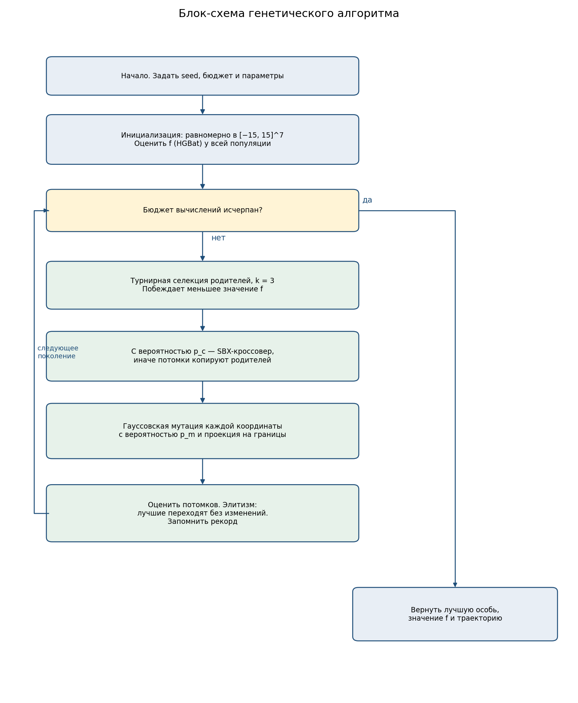
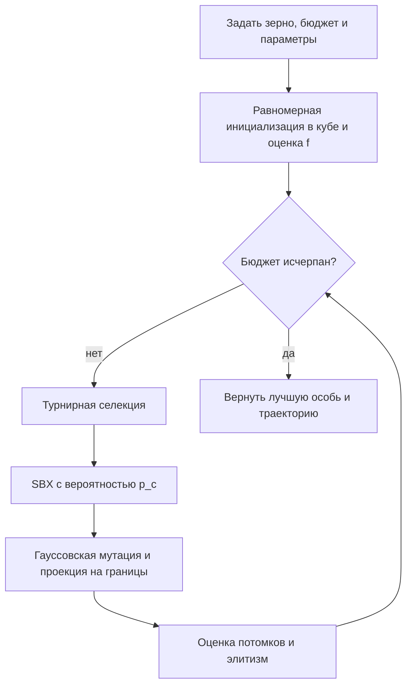
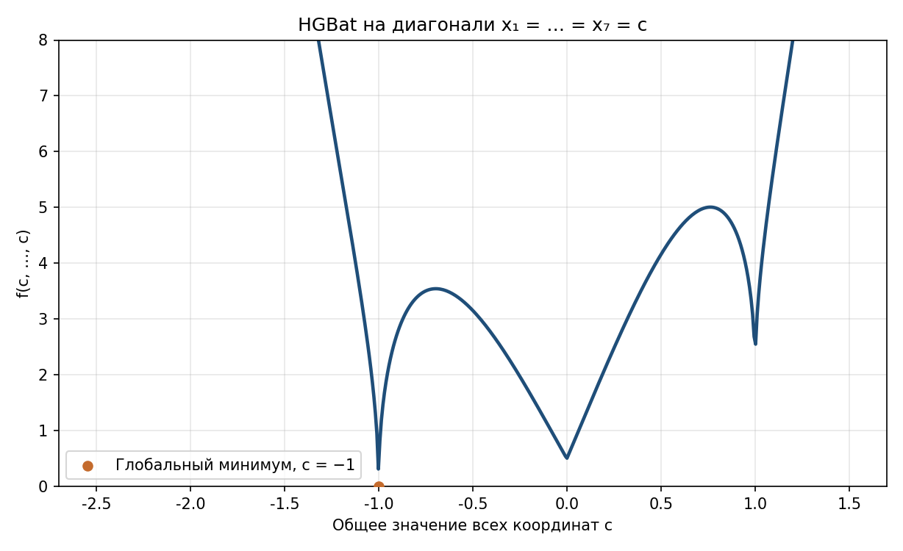

# Лабораторная работа № 1. HGBat, вариант 20

Группа Б24-527, порядковый номер в группе 7.

## 1. Постановка и индивидуальный вариант

Нужно приблизить глобальный минимум непрерывной функции на ограниченном кубе вещественным генетическим алгоритмом.

Номер варианта считается по формуле методички. Для группы 527 индекс Q равен 2, две последние цифры года осеннего семестра 2026 — Y = 26, номер в списке N = 7.

```text
17·N + 7·Q + Y = 17·7 + 7·2 + 26 = 159
V = 1 + (159 mod 20) = 1 + 19 = 20
d = 5 + (V mod 6) = 5 + 2 = 7
```

Вариант 20 — функция HGBat. Область поиска: −15 ≤ xᵢ ≤ 15.

## 2. Пространство решений, целевая функция и ограничения

Ищется

```text
min f(x),  x ∈ [−15, 15]^7
```

```text
f(x) = |(Σ xᵢ²)² − (Σ xᵢ)²|^(1/2) + (0.5·Σ xᵢ² + Σ xᵢ) / d + 0.5
```

Второе слагаемое совпадает с гладкой чашей

```text
(1 / (2d)) · Σ (xᵢ + 1)²
```

Оно неотрицательно и равно нулю только при xᵢ = −1. Первое слагаемое тоже неотрицательно и в этой же точке равно нулю: Σ xᵢ² = d и (Σ xᵢ)² = d². Значит глобальный минимум единственный:

```text
f(−1, …, −1) = 0
```

Других ограничений нет: куб и есть область D. Выход за границу не штрафуется, координата проецируется обратно на отрезок [−15, 15].

Формула совпадает с несмещённой HGBat из набора CEC 2014. Для этой постановки минимум выведен аналитически, а не взят из таблицы соревнования.

## 3. Представление особи

Генотип и фенотип — один и тот же вектор из семи вещественных чисел. Отдельного декодирования нет. Особь допустима, если каждая координата лежит в [−15, 15]. Начальная популяция берётся независимо и равномерно в этом кубе.

## 4. Алгоритм, операторы и параметры

Поколенческий генетический алгоритм. Остановка — исчерпание бюджета в 10 000 вычислений функции, а не фиксированное число поколений. При размере популяции 50 и двух элитных особях это 208 поколений: 50 оценок на старте, затем 207 поколений по 48 потомков и короткое последнее поколение на оставшиеся 14 оценок.

Схема одного поколения:

1. Турнир из 3 особей. Побеждает меньшее значение f. Родители выбираются с возвращением.
2. С вероятностью p_c = 0.9 пара проходит SBX-кроссовер с η = 15. Каждая координата скрещивается с вероятностью 0.5, остальные копируются. Иначе потомки совпадают с родителями.
3. Гауссовская мутация: координата сдвигается на N(0, σ²) с вероятностью p_m, σ = 0.8.
4. Проекция на куб.
5. Элитизм: две лучшие особи переходят в следующее поколение без изменений. Рекорд по запуску поэтому не ухудшается.

Сравниваются две конфигурации. Отличается только p_m: 0.10 и 0.40. Общие параметры записаны в `config.json`.

| Параметр | Значение |
| --- | --- |
| Размер популяции | 50 |
| Турнир | 3 |
| Вероятность кроссовера | 0.9 |
| η SBX | 15 |
| Вероятность скрещивания координаты | 0.5 |
| σ мутации | 0.8 |
| Элита | 2 |
| Бюджет | 10 000 вычислений |
| Число запусков | 20 |
| Базовое зерно | 20261028 |

Зерно запуска i равно 20261028 + i и одно и то же у генетического алгоритма и у случайного поиска.

Дополнительно к обязательному набору операторов реализован SBX-кроссовер Деба: потомки учитывают расстояние между родителями и не выходят за границы области. Обычный одноточечный кроссовер для вещественного вектора здесь не использовался.

Случайный поиск при том же бюджете равномерно берёт 10 000 точек и запоминает лучшую. Это база для сравнения, а не второй эволюционный алгоритм.

## 5. Блок-схема





## 6. Почему выбраны эти операторы

Функция несепарабельная: первое слагаемое связывает все координаты сразу. Турнир размера 3 даёт давление отбора без необходимости переводить минимизацию в задачу максимизации, как это пришлось бы делать для рулетки.

SBX с η = 15 строит потомка между родителями и ближе к ним, чем к центру отрезка. На непрерывном кубе это сохраняет уже найденные удачные координаты и при этом остаётся внутри границ. Проекция после мутации — простое правило допустимости: оптимум внутренний, поэтому притяжение к границе не закрывает минимум.

Элитизм нужен, потому что гауссовский шаг σ = 0.8 легко разрушает редкое улучшение. Две элитные особи держат рекорд, остальные продолжают искать.

Фиксированный σ = 0.8 — компромисс на кубе ширины 30. Более крупный шаг срывает популяцию с узкой долины, более мелкий слишком долго идёт к ней от случайного старта. Сравнение ниже меняет не этот шаг, а только вероятность, с которой шаг применяется к координате.

## 7. Результаты 20 запусков

Полная таблица — `results/runs.csv`. Сводка — `results/summary.csv`.

| Метод | Лучшее | Среднее | Медиана | СКО | Худшее |
| --- | ---: | ---: | ---: | ---: | ---: |
| ГА, p_m = 0.10 | 0.0402 | 0.2639 | 0.2882 | 0.1068 | 0.3825 |
| ГА, p_m = 0.40 | 0.0872 | 0.2070 | 0.1964 | 0.0586 | 0.3347 |
| Случайный поиск | 20.85 | 39.89 | 39.55 | 10.11 | 62.76 |

Лучшая найденная точка получена при p_m = 0.10, зерно 20261036, f = 0.0402, расстояние до (−1, …, −1) равно 0.750:

```text
(−1.336, −1.049, −0.628, −1.029, −0.644, −0.601, −1.149)
```

Среднее расстояние до оптимума: 1.82 при p_m = 0.10, 1.26 при p_m = 0.40 и 6.72 у случайного поиска. Среднее время одного запуска генетического алгоритма около 0.20 с. У случайного поиска оно меньше, потому что выборка векторная. Сравнивать методы нужно по числу вычислений функции: оно у всех равно 10 000.

Порог f ≤ 0.1 достигнут в 2 запусках из 20 при p_m = 0.10 (медиана момента — 2930 вычислений) и в 1 запуске из 20 при p_m = 0.40 (3938 вычислений). Порог 0.01 не достигнут ни разу.

Графики:

- лучшее значение по поколениям, минимум, среднее и максимум серии при p_m = 0.10 — `results/figures/convergence_generations.png`;
- те же кривые для двух вероятностей мутации — `results/figures/config_comparison.png`;
- среднее лучшее значение против числа вычислений, вместе со случайным поиском — `results/figures/ga_vs_random.png`;
- распределение итоговых значений — `results/figures/final_boxplot.png`.

## 8. Анализ

Оба генетических алгоритма за первые примерно 2000 вычислений снижают среднее лучшее значение со ~150 до ~0.4. Дальше кривые почти плоские и остаются в диапазоне 0.2–0.3. Случайный поиск за весь бюджет доходит только до среднего около 40 и к концу всё ещё медленно улучшается: удачная точка в кубе объёма 30^7 редка.

Координатный спуск с убывающим шагом, 15 случайных стартов (`results/landscape.json`): лучшее 0.225, среднее 0.694, худшее 1.511. Градиентный спуск по конечным разностям, 12 стартов: лучшее 0.247, среднее 0.624, худшее 1.092. Средний результат генетического алгоритма при p_m = 0.40 лучше обоих локальных методов и примерно в 190 раз меньше среднего результата случайной выборки.

Разброс честный: при p_m = 0.10 стандартное отклонение 0.107 сравнимо со средним. Один удачный запуск нельзя выдавать за поведение метода. Медиана 0.288 близка к среднему, так что среднее не держится на одном выбросе.

## 9. Влияние вероятности мутации

Единственное различие конфигураций — p_m.

Рост p_m с 0.10 до 0.40 уменьшил среднее с 0.264 до 0.207, медиану с 0.288 до 0.196 и стандартное отклонение с 0.107 до 0.059. Худший запуск тоже стал лучше: 0.335 против 0.382. При этом рекорд серии остался за редкой мутацией: 0.040 против 0.087.

Чаще мутировать координаты полезнее для устойчивого попадания в широкую долину. Редкая мутация иногда сохраняет уже хорошую комбинацию координат и даёт более глубокий одиночный результат, но чаще популяция застывает выше. После выхода на плато дальнейшие поколения при фиксированном σ = 0.8 почти не меняют рекорд: шаг слишком велик для иглы вокруг глобального минимума и слишком мал, чтобы надёжно перепрыгивать хребты.

## 10. Насколько результат хорош именно для этой задачи

Результат приемлемый как сравнение методов и недостаточный как приближение глобального минимума.

Приемлемый, потому что при одинаковом бюджете генетический алгоритм устойчиво находит область со значением около 0.2, тогда как случайная выборка остаётся около 40, а локальный спуск в среднем остаётся около 0.6–0.7. Алгоритм воспроизводим: зерно, параметры и таблицы сохранены.

Недостаточный, потому что известный минимум равен 0, а лучшее найденное значение — 0.040. Ни один из 20 запусков не дошёл до 0.01. Это не сбой элитизма: рекорд внутри запуска не растёт. Поиск останавливается в другой яме.

Причина видна на срезе функции. Если все координаты равны c, между c = 0, где f = 0.5, и глобальным минимумом c = −1 стоят хребты высотой больше 3.



Около самой точки минимума игла узкая. На сфере радиуса 0.05 вокруг (−1, …, −1) медиана f по 40 случайным направлениям равна 0.70, то есть типичная точка вплотную к оптимуму уже хуже обычного результата генетического алгоритма. Координатный и градиентный спуски тоже не попадают в эту иглу: первое слагаемое несепарабельно и недифференцируемо на поверхности (Σ xᵢ²)² = (Σ xᵢ)², а гладкая чаша сама по себе не проводит траекторию сквозь хребет.

Вывод такой: алгоритм отличает широкую долину от случайных точек куба, но бюджет в 10 000 оценок и фиксированный гауссовский шаг не достаточны, чтобы претендовать на глобальный минимум HGBat.
