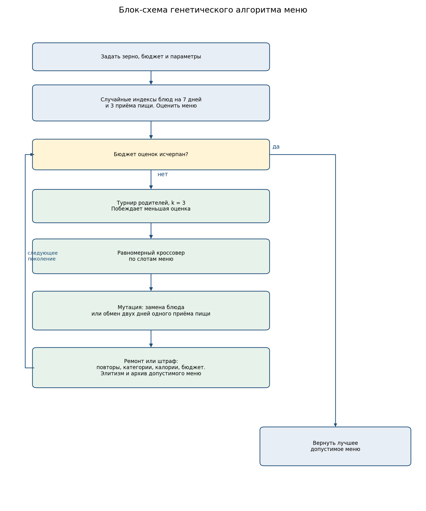
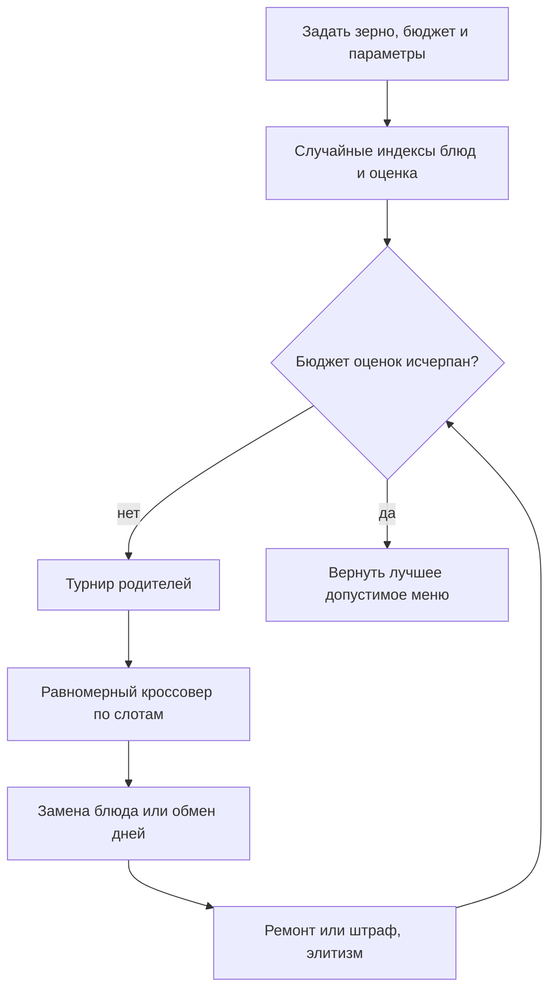

# Лабораторная работа № 2. Меню на неделю, вариант 20

Группа Б24-527, порядковый номер в группе 7.

## 1. Постановка и вариант

Нужно составить меню на неделю минимальной стоимости при ограничениях на калории, бюджет и разнообразие.

Номер варианта тот же, что в лабораторной работе № 1:

```text
17·N + 7·Q + Y = 17·7 + 7·2 + 26 = 159
V = 1 + (159 mod 20) = 20
```

Для группы 527 индекс Q равен 2, год осеннего семестра 2026 даёт Y = 26, номер в списке N = 7. Вариант 20 — формирование меню. Представление по методичке — целочисленный вектор.

Каталог синтетический, зерно данных зафиксировано самим списком блюд в `src/catalog.py` и в `data/dishes.json`. В нём 36 блюд: 12 завтраков, 12 обедов и 12 ужинов. В каждом приёме пищи четыре категории, по три блюда.

Горизонт — 7 дней, три приёма пищи в день, 21 слот.

## 2. Пространство решений, цель и ограничения

Решение — матрица целых чисел размера 7×3. Элемент `x[день, приём]` — номер блюда в каталоге этого приёма пищи, от 0 до 11. Завтрак нельзя подставить в слот ужина: у каждого слота свой каталог.

Цель: минимизировать суммарную стоимость недели в рублях.

Ограничения:

1. Калорийность каждых суток от 1600 до 2300 ккал.
2. Стоимость недели не выше 2800 руб.
3. Разнообразие: внутри одного приёма пищи все семь блюд различны, и за неделю встречаются все четыре категории этого приёма.

Допустимое меню поэтому содержит 21 разное блюдо. Повторы, пропуск категории, выход калорий за границы суток и превышение бюджета делают решение недопустимым.

Декодирование прямое: индекс в каталоге даёт название, категорию, ккал и цену. Отдельного фенотипа нет.

## 3. Почему кодирование отражает структуру

Слот меню — это конкретный день и конкретный приём пищи, а не свободный вещественный вес. Целый индекс блюда это и записывает. Соседние гены — соседние приёмы одного дня, поэтому равномерный кроссовер смешивает дни, не ломая тип приёма пищи. Обмен двух позиций внутри одного столбца меняет календарь, но сохраняет набор завтраков, обедов или ужинов: число повторов и покрытие категорий при такой мутации не меняются. Замена индекса на случайный добавляет новое блюдо и как раз может нарушить эти ограничения. Оба оператора поэтому осмысленны именно для этого вектора, а не взяты из вещественного алгоритма первой работы.

## 4. Алгоритм и параметры

Поколенческий генетический алгоритм, остановка по 4000 оценкам меню. Популяция 40, турнир из 3, две элитные особи. Равномерный кроссовер применяется с вероятностью 0.8: каждая позиция независимо берётся у одного из родителей.

Две мутации:

- замена: каждая позиция с вероятностью 0.25 получает новый индекс своего каталога;
- обмен: в каждом приёме пищи один раз меняются местами два случайных дня.

Два способа ограничений:

- штраф: оценка = стоимость + 8·(ккал вне диапазона) + 500·(число повторов) + 500·(число пропущенных категорий) + 2·(рубли сверх бюджета);
- ремонт: перед оценкой убираются повторы, добираются недостающие категории, затем замены уменьшают выход калорий за границы и превышение бюджета. Ремонт делает ограниченное число замен и не гарантирует успех на каждом шаге, но в экспериментах почти всегда приводит к допустимому меню. После ремонта оценка совпадает со стоимостью, если нарушений не осталось.

Сравниваются две пары, в каждой меняется один фактор:

| Настройка | Ограничения | Мутация |
| --- | --- | --- |
| Ремонт, замена блюда | ремонт | замена |
| Штраф, замена блюда | штраф | замена |
| Ремонт, обмен дней | ремонт | обмен |

База сравнения — случайная выборка тех же 4000 меню с тем же ремонтом. Отдельно 20 раз запускается жадная эвристика: для каждого приёма пищи берутся самые дешёвые блюда, покрывающие все четыре категории, раскладываются по дням и проходят тот же ремонт. У эвристики одна сборка на запуск, бюджет оценок с генетическим алгоритмом у неё не совпадает. Сопоставимый бюджет есть у случайного поиска с ремонтом.

Зерно запуска `i` равно 20261028 + `i`.

## 5. Блок-схема





## 6. Допустимые и недопустимые примеры

Полные таблицы лежат в `results/examples.txt`.

Недопустимое меню 1 — каждый день одна и та же овсянка, гороховый суп и тушёный картофель. Стоимость 1330 руб., но 18 повторов и 9 пропущенных категорий.

Недопустимое меню 2 — семь самых дорогих блюд каждого приёма пищи без повтора внутри столбца. Калории в основном внутри диапазона, однако не хватает трёх категорий и бюджет превышен на 745 руб.: стоимость 3545 руб. при пределе 2800.

Допустимое меню 1 стоит 2513 руб., допустимое меню 2 — 2585 руб. В обоих нет повторов, представлены все категории, каждые сутки попадают в 1600–2300 ккал, бюджет не превышен.

## 7. Результаты 20 запусков

Сводка по лучшей допустимой стоимости, в рублях. Для штрафа среднее, медиана, СКО и худшее посчитаны только по тем запускам, где допустимое меню вообще нашлось.

| Метод | Успех | Лучшее | Среднее | Медиана | СКО | Худшее |
| --- | ---: | ---: | ---: | ---: | ---: | ---: |
| Ремонт, замена блюда | 20/20 | 2133 | 2208 | 2204 | 40 | 2263 |
| Ремонт, обмен дней | 20/20 | 2173 | 2227 | 2222 | 31 | 2278 |
| Случайный поиск с ремонтом | 20/20 | 2168 | 2286 | 2291 | 39 | 2335 |
| Жадная эвристика | 20/20 | 2278 | 2346 | 2335 | 45 | 2443 |
| Штраф, замена блюда | 10/20 | 2323 | 2633 | 2647 | 137 | 2785 |

Лучшее меню найдено ремонтом с заменой блюда, зерно 20261039, 2133 руб.

| День | Завтрак | Обед | Ужин | Ккал | Руб. |
| --- | --- | --- | --- | ---: | ---: |
| Пн | Оладьи | Гуляш с макаронами | Салат из капусты | 1640 | 355 |
| Вт | Блинчики | Овощное рагу с хлебом | Рис с овощами | 1670 | 300 |
| Ср | Творог 5% | Минтай с рисом | Скумбрия запечённая | 1640 | 425 |
| Чт | Овсянка на воде | Борщ | Тефтели в соусе | 1660 | 325 |
| Пт | Пшённая каша | Гороховый суп с хлебом | Гречка с овощами | 1600 | 198 |
| Сб | Яичница с хлебом | Котлета с пюре | Овощной салат | 1620 | 315 |
| Вс | Гречневая каша | Куриная лапша | Картофель тушёный | 1600 | 215 |

Все семь завтраков, обедов и ужинов различны. У завтраков есть каша, яичное, творог и выпечка, у обедов — суп, мясо, рыба и салат, у ужинов — гарнир, мясо, рыба и салат. Каждые сутки не ниже 1600 и не выше 1670 ккал. 2133 руб. меньше предела 2800.

Графики:

- стоимость по поколениям для ремонта с заменой — `results/figures/convergence_generations.png`;
- штраф против ремонта — `results/figures/constraint_comparison.png`;
- две мутации — `results/figures/mutation_comparison.png`;
- генетический алгоритм против случайного поиска — `results/figures/ga_vs_random.png`;
- распределения итоговой стоимости — `results/figures/final_boxplot.png`.

На графике штрафа среднее считается только по запускам, которые к этому моменту уже нашли допустимое меню. Поэтому кривая может чуть подняться, когда поздний запуск впервые попадает в допустимую область дорогим меню. Внутри одного запуска архив лучшего допустимого меню не ухудшается.

## 8. Сравнение ограничений и операторов

Ремонт полезнее штрафа. При замене блюда ремонт даёт допустимое меню во всех 20 запусках, среднее 2208 руб. Штраф доходит до допустимого меню только в 10 запусках из 20, и даже среди них среднее 2633 руб., а лучший результат 2323 руб. хуже худшего запуска с ремонтом (2263 руб.). Штраф умеет снижать число нарушений, но за 4000 оценок часто остаётся рядом с границей области и не закрепляет допустимое дешёвое меню. Ремонт сразу возвращает решение в область и оставляет генетическому алгоритму оптимизацию стоимости.

Замена блюда немного лучше обмена дней: среднее 2208 против 2227 руб., лучшее 2133 против 2173. Обмен сохраняет набор блюд и может только удачнее разложить их по дням. Замена способна выбросить дорогое блюдо и поставить более дешёвое, если ремонт удерживает калории и категории. Разброс у обмена меньше (СКО 31 против 40), но уровень стоимости выше. Для этой задачи полезнее оператор, который меняет состав меню, а не только календарь.

## 9. Сравнение с эвристикой и случайным поиском

При тех же 4000 оценках и том же ремонте случайный поиск в среднем останавливается на 2286 руб. Генетический алгоритм с заменой блюда — на 2208 руб., примерно на 80 руб. дешевле. Худший запуск алгоритма (2263) лучше среднего случайного поиска. Жадная сборка дешёвых блюд с последующим ремонтом даёт в среднем 2346 руб. и ни разу не опускается ниже 2278. Она быстро строит допустимое меню, но выбирает дешёвые блюда по отдельности и не перебирает сочетания суток. Алгоритм это сочетание как раз ищет.

Отрыв от случайного поиска меньше, чем в первой лабораторной на HGBat: ремонт сам по себе уже сильный конструктор и поднимает случайную точку в допустимую область около 2300 руб. Эволюции остаётся сэкономить около 100 руб. внутри узкого калорийного коридора.

## 10. Насколько результат хорош для этой задачи

Для поставленной цели — дешёвое допустимое меню — результат хороший. Лучшие 2133 руб. удовлетворяют всем ограничениям, все 20 запусков ремонта с заменой укладываются в 2133–2263 руб., и этот интервал лучше и жадной эвристики, и случайного поиска с тем же бюджетом.

Меню прижато к нижней границе калорийности: сутки стоят 1600–1670 ккал при разрешённых 2300. Так и должен вести себя поиск минимума цены, когда лишние калории обычно стоят денег, а нижняя граница обязательна. Бюджет 2800 при этом почти не давит на найденные меню: активные ограничения — пол калорий и разнообразие. Если бы цель включала комфортный запас калорий или предпочтения по вкусу, этого меню было бы мало. В формулировке варианта такого критерия нет.
